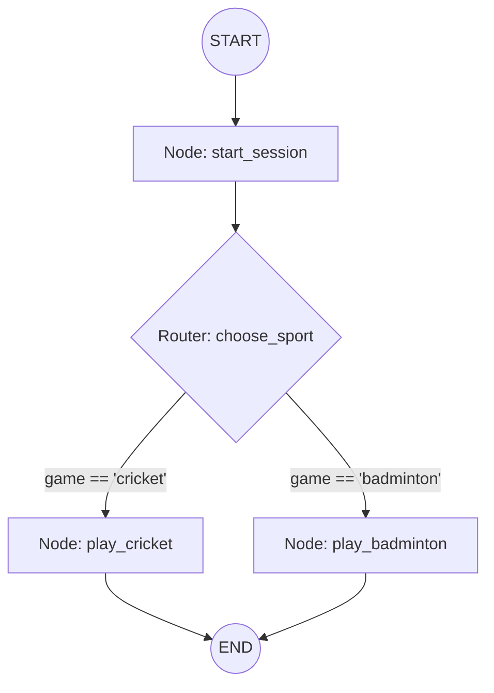

# Topic 01: State Schema with TypedDict

Welcome to **Topic 01** of the LangGraph Components course. This module covers the simplest, fastest, and most common way to define state in LangGraph: **`TypedDict`**.

---

## 🎯 Learning Objectives

By the end of this module, you will understand:
1. What a **State Schema** is in LangGraph and why it acts as the "shared notebook" for all nodes.
2. How to define a state using Python's standard `typing_extensions.TypedDict`.
3. How nodes read from state using standard dictionary keys (`state["key"]`) and update state by returning partial dictionaries.
4. How **Conditional Routing** (`add_conditional_edges`) directs the execution flow based on state contents.
5. The **critical limitation** of `TypedDict`: it provides static type hints for your IDE/linter, but **zero runtime validation**.

---

## 🧠 Mental Model & Conceptual Breakdown

In LangGraph, every workflow is a **State Machine**. Think of the **State** as a shared clipboard passed from person to person in an assembly line:

```
┌─────────────────────────────────────────────────────────────┐
│                    SHARED GRAPH STATE                       │
│  {                                                          │
│     "name": "Krish",                                        │
│     "game": "cricket",                                      │
│     "status": "batting in T20 match"                        │
│  }                                                          │
└─────────────────────────────────────────────────────────────┘
          ▲                                ▲
          │ reads/updates                  │ reads/updates
┌──────────────────┐             ┌──────────────────┐
│   Node A:        │             │   Node B:        │
│   start_session  │             │   play_cricket   │
└──────────────────┘             └──────────────────┘
```

1. **State Definition:** You declare the schema once when initializing `StateGraph(PlayerState)`.
2. **Node Execution:** Each node receives a copy of the current state, reads the fields it needs, does work, and returns a dictionary with *only the fields it changed*.
3. **State Merging:** LangGraph takes the returned dictionary and merges those keys into the central state.

---

## 🔄 Graph Architecture & Flow

Here is the exact topology of the graph implemented in `main.py`:



### Detailed Flow Steps:
1. **`START -> start_session`:** The player enters the system. Node `start_session` reads `state["name"]` and sets `status`.
2. **`start_session -> choose_sport`:** A conditional edge function checks `state.get("game")`.
   - If `"cricket"`, it routes to `play_cricket`.
   - If `"badminton"`, it routes to `play_badminton`.
   - If no preference was provided, it picks one at random!
3. **Game Node -> `END`:** The selected sport node runs, updates `game` and `status`, and transitions to `END`.

---

## 💻 Code Walkthrough

### 1. Defining the State
```python
from typing import Literal
from typing_extensions import TypedDict

class PlayerState(TypedDict):
    name: str
    game: Literal["cricket", "badminton"]
    status: str
```
- `TypedDict` gives editor autocompletion for `state["name"]`, `state["game"]`, etc.
- `Literal["cricket", "badminton"]` restricts the allowable strings in static analysis.

### 2. Writing Node Functions
```python
def start_session(state: PlayerState) -> dict:
    return {"status": f"{state['name']} has entered the recreation arena."}
```
> [!TIP]
> Notice the node returns `{"status": ...}` — **only the updated key**. You do NOT need to return the entire `PlayerState` dictionary! LangGraph merges returned keys into the existing state automatically.

### 3. Conditional Routing Function
```python
def choose_sport(state: PlayerState) -> Literal["play_cricket", "play_badminton"]:
    selected_game = state.get("game")
    if selected_game in ("cricket", "badminton"):
        return f"play_{selected_game}"
    return "play_cricket"
```

### 4. Assembling and Compiling the Graph
```python
builder = StateGraph(PlayerState)
builder.add_node("start_session", start_session)
builder.add_node("play_cricket", play_cricket)
builder.add_node("play_badminton", play_badminton)

builder.add_edge(START, "start_session")
builder.add_conditional_edges("start_session", choose_sport, {
    "play_cricket": "play_cricket",
    "play_badminton": "play_badminton",
})
builder.add_edge("play_cricket", END)
builder.add_edge("play_badminton", END)

graph = builder.compile()
```

---

## ⚠️ Critical Gotcha: No Runtime Type Validation

`TypedDict` is **static only**. Python's interpreter ignores `TypedDict` type hints while running.
If you invoke the graph with an integer instead of a string:
```python
graph.invoke({"name": 123, "game": "cricket", "status": "Testing"})
```
It will **NOT crash**! It accepts `123` silently.
- If you need strict runtime validation (e.g. from an API request or user form), use **Topic 03: Pydantic State Schema**.

---

## 🚀 How to Run

From the project root:
```powershell
python 10_LangGrapph_Component/01_state_schema_typeddict/main.py
```

Or from inside this directory:
```powershell
cd 10_LangGrapph_Component/01_state_schema_typeddict
python main.py
```

---

## 📝 Summary Checklist

| Concept | Explanation |
|---|---|
| **What is State?** | Central dictionary-like container passed between all nodes. |
| **Why TypedDict?** | Standard Python, zero overhead, dictionary syntax, editor autocompletion. |
| **Node Return Value** | Return a partial dict with only the keys that changed. |
| **add_conditional_edges** | Routes to different nodes based on state evaluation. |
| **Limitation** | No runtime checks; for validation, choose Pydantic. |
