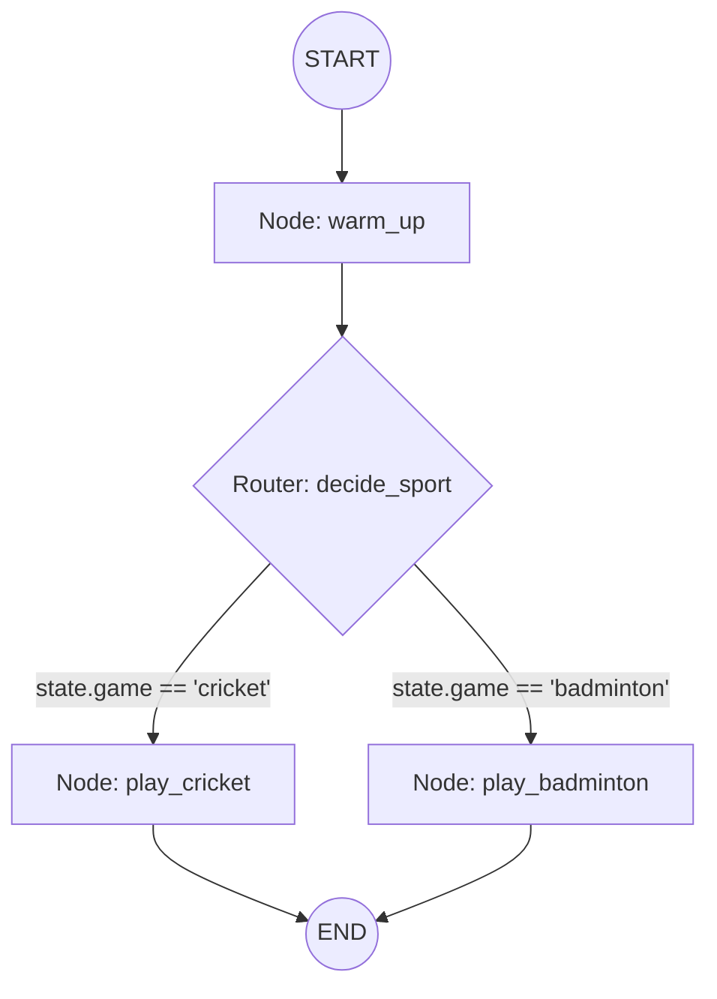

# Topic 02: State Schema with Python Dataclasses

Welcome to **Topic 02** of the LangGraph Components course. This module explores how to use Python's native `@dataclass` decorator to build structured, object-oriented State Schemas in LangGraph.

---

## 🎯 Learning Objectives

By the end of this module, you will understand:
1. How to define a LangGraph state using Python's standard `@dataclass` decorator.
2. The advantages of **attribute access (dot notation)** like `state.name` over dictionary keys `state['name']`.
3. How to provide **default field values** (`score: int = 0`) and attach **custom methods** directly to the state class.
4. How LangGraph automatically coerces input dictionaries into your Dataclass, and allows nodes to still return standard dictionaries for state updates.
5. Why Dataclasses, like `TypedDict`, still do **not** perform runtime type enforcement.

---

## 🧠 Mental Model: TypedDict vs. Dataclass

| Feature | TypedDict (Topic 01) | Dataclass (Topic 02) |
|---|---|---|
| **Syntax Style** | Dictionary keys: `state["name"]` | Dot notation: `state.name` |
| **Default Values** | Difficult/Verbose | Simple: `score: int = 0` |
| **Methods & Helpers** | ❌ No methods allowed |  Yes: `state.summary()` |
| **Runtime Validation** | ❌ None | ❌ None (types not enforced) |
| **Node Updates** | Returns `{...}` dict | Returns `{...}` dict (LangGraph merges automatically!) |

```
┌─────────────────────────────────────────────────────────────┐
│                 DATACLASS STATE OBJECT                      │
│  @dataclass                                                 │
│  class PlayerDataClassState:                                │
│      name: str                                              │
│      game: str = "cricket"                                  │
│      score: int = 0                                         │
│                                                             │
│      def summary(self) -> str: ...                          │
└─────────────────────────────────────────────────────────────┘
          ▲                                ▲
          │ state.name                     │ state.score + 50
┌──────────────────┐             ┌──────────────────┐
│   Node: warm_up  │             │ Node:play_cricket│
│   returns dict   │             │ returns dict     │
└──────────────────┘             └──────────────────┘
```

---

## 🔄 Graph Architecture & Flow



### Execution Steps:
1. **`START -> warm_up`:** Player begins stretching. Node reads `state.name` and increments `score` by `5`.
2. **`warm_up -> decide_sport`:** Router checks `state.game`.
   - If `"cricket"` -> routes to `play_cricket`.
   - If `"badminton"` -> routes to `play_badminton`.
   - If unassigned (`None`), routes randomly with 50/50 probability.
3. **`play_cricket` / `play_badminton` -> `END`:** Player scores points (`+50` for cricket boundary, `+30` for badminton smash), updates status, and reaches `END`.

---

## 💻 Code Walkthrough

### 1. Defining the Dataclass State
```python
from dataclasses import dataclass
from typing import Literal, Optional

@dataclass
class PlayerDataClassState:
    name: str
    game: Optional[Literal["cricket", "badminton"]] = None
    score: int = 0
    status: str = "Initialized"

    def summary(self) -> str:
        return f"Player: {self.name} | Sport: {self.game} | Score: {self.score}"
```

### 2. Node Functions Use Dot Notation
```python
def warm_up(state: PlayerDataClassState) -> dict:
    # Read using dot notation!
    print(f"{state.name} is warming up. Current score: {state.score}")
    # Return dictionary with updates!
    return {
        "status": f"{state.name} finished warm-up.",
        "score": state.score + 5
    }
```
> [!NOTE]
> Even though state is an object, nodes **return standard Python dictionaries**. LangGraph takes those dictionary updates and applies them to the fields of the dataclass automatically.

### 3. Both Formats Accepted on Graph Invocation
You can invoke the compiled graph with either:
1. **A Dataclass instance:** `graph.invoke(PlayerDataClassState(name="Krish", game="cricket"))`
2. **A standard dictionary:** `graph.invoke({"name": "Piyush", "game": "badminton"})` (LangGraph auto-coerces it!)

---

## 🚀 How to Run

From the project root:
```powershell
python 10_LangGrapph_Component/02_state_schema_dataclass/main.py
```

Or from inside this directory:
```powershell
cd 10_LangGrapph_Component/02_state_schema_dataclass
python main.py
```

---

## 📝 Summary Checklist

| Concept | Explanation |
|---|---|
| **Dot Notation** | Read fields cleanly with `state.field` instead of `state['field']`. |
| **Default Values** | Initial values like `score: int = 0` are assigned automatically if omitted. |
| **Helper Methods** | Attach domain methods directly to the state class (e.g. `state.summary()`). |
| **Dictionary Updates** | Nodes continue returning partial dicts; LangGraph updates the dataclass fields. |
| **Validation Note** | Still static-only; for strict constraints (`score >= 0`), use Pydantic (Topic 03). |
