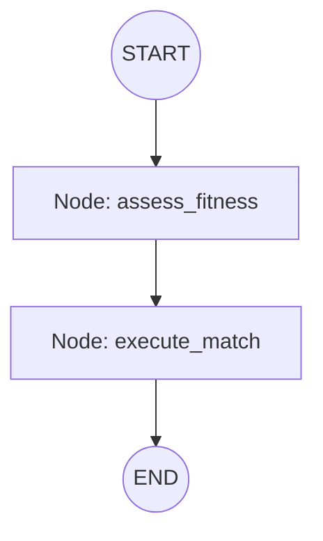

# Topic 03: State Schema with Pydantic (Runtime Validation)

Welcome to **Topic 03** of the LangGraph Components course. This module covers defining State Schemas with **Pydantic `BaseModel`**, the industry standard for production APIs, webhooks, and secure agentic workflows.

---

## 🎯 Learning Objectives

By the end of this module, you will understand:
1. Why **runtime data validation** is mandatory when building production AI applications.
2. How Pydantic `BaseModel` catches invalid inputs **before** any graph node executes.
3. How **type coercion** automatically repairs compatible data types (e.g., converting string `"28"` to integer `28`).
4. How to use `Field(ge=..., le=...)` for numeric bounds and string length constraints.
5. How to write custom `@field_validator` functions for domain logic (e.g. enforcing ID prefixes).
6. The dangerous **Python shadowing trap**: why you must *never* name a file `pydantic.py`.

---

## 🧠 Mental Model: The Security Guard at the Door

Think of Pydantic as the security guard stationed at the entrance of your LangGraph:

```
                  UNTRUSTED INPUT
     {"player_id": "bad", "age": 2, "game": "football"}
                            │
                            ▼
              ┌───────────────────────────┐
              │    PYDANTIC VALIDATION    │
              │  (PlayerPydanticState)    │
              └─────────────┬─────────────┘
                            │
            ┌───────────────┴───────────────┐
            │                               │
       VALID DATA                     INVALID DATA
            │                               │
            ▼                               ▼
    ┌───────────────┐               ┌───────────────┐
    │  Enter Graph  │               │ RAISE ERROR!  │
    │  Node 1, 2... │               │ValidationError│
    └───────────────┘               └───────────────┘
                                     (Blocks execution
                                      before any node runs!)
```

Neither `TypedDict` nor standard `@dataclass` enforce types at runtime. If an untrusted API sends `{"age": "negative"}`:
- `TypedDict` lets it through -> downstream nodes crash with unexpected bugs.
- `Pydantic` stops it at the door -> raises `ValidationError` with clear error messages.

---

## 🔄 Graph Architecture & Flow



### Execution Steps:
1. **Input Validation:** Pydantic checks all fields upon graph invocation (`invoke()`). If any rule fails, execution halts immediately with `ValidationError`.
2. **`START -> assess_fitness`:** The node evaluates player vitals based on `age`, deducts a stamina burn (10% or 15%), and updates `status`.
3. **`assess_fitness -> execute_match`:** The match is simulated based on `game`. Further stamina is consumed (30% for cricket, 20% for badminton).
4. **`execute_match -> END`:** Final state is returned with updated stamina and status logs.

---

## 💻 Code Walkthrough

### 1. Defining Pydantic State Schema
```python
from typing import Literal
from pydantic import BaseModel, Field, field_validator

class PlayerPydanticState(BaseModel):
    player_id: str = Field(..., description="Unique alphanumeric player identifier")
    name: str = Field(..., min_length=2, max_length=50)
    age: int = Field(..., ge=5, le=100)
    game: Literal["cricket", "badminton"]
    stamina: int = Field(default=100, ge=0, le=100)
    status: str = Field(default="Registered")

    @field_validator("player_id")
    @classmethod
    def validate_player_id(cls, value: str) -> str:
        upper_val = value.upper()
        if not upper_val.startswith("PL-"):
            raise ValueError(f"player_id must start with 'PL-'. Got: '{value}'")
        return upper_val
```

### 2. Node Functions
```python
def assess_fitness(state: PlayerPydanticState) -> dict:
    stamina_burn = 10 if state.age < 40 else 15
    new_stamina = max(0, state.stamina - stamina_burn)
    return {
        "stamina": new_stamina,
        "status": f"{state.name} cleared fitness check with {new_stamina}% stamina."
    }
```

---

## ⚠️ The Python Shadowing Trap

> [!CAUTION]
> **NEVER name any local file `pydantic.py`!**
> Python searches the current directory before installed site-packages. If you name your file `pydantic.py`, any `import pydantic` statement will import *your empty file* instead of the official library, breaking imports across the entire project with `ImportError: cannot import name 'BaseModel'`.

---

## 🚀 How to Run

From the project root:
```powershell
python 10_LangGrapph_Component/03_state_schema_pydantic/main.py
```

Or from inside this directory:
```powershell
cd 10_LangGrapph_Component/03_state_schema_pydantic
python main.py
```

---

## 📝 Summary Checklist

| Feature | Behavior in Pydantic |
|---|---|
| **Invalid Type** | Rejects with `ValidationError` (`age='abc'`). |
| **Type Coercion** | Converts compatible types safely (`age='28'` becomes `28`). |
| **Field Constraints** | Rejects numbers outside bounds (`ge=5, le=100`). |
| **Custom Validator** | Runs domain rules (e.g. prefix checking) with `@field_validator`. |
| **When to Use** | Always use Pydantic for public APIs, webhooks, or LLM-structured outputs. |
