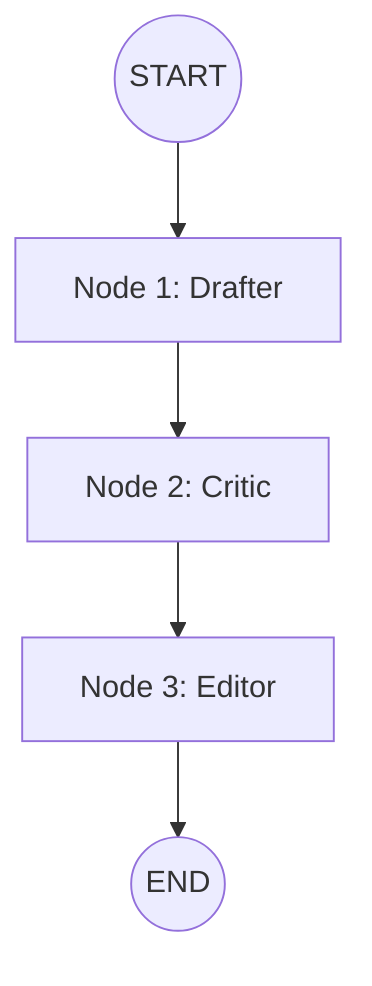
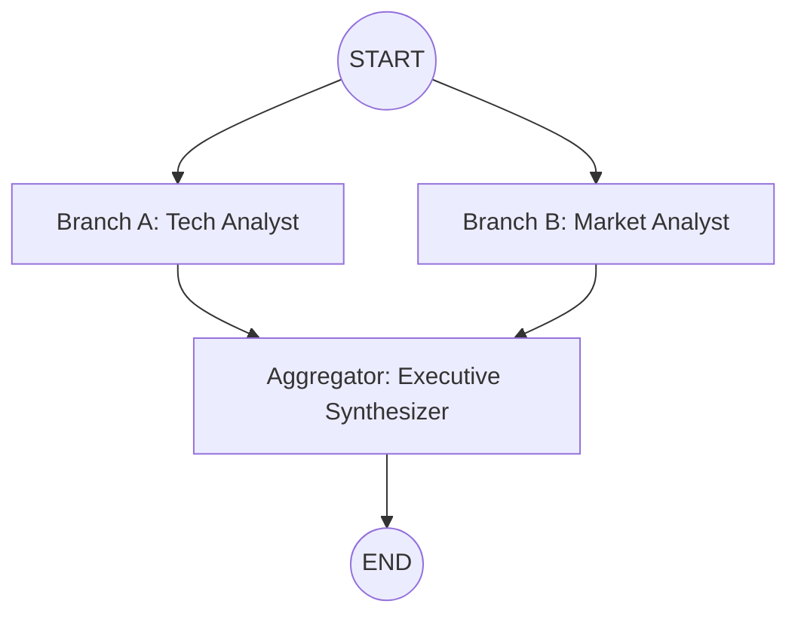

# Topic 05: Chains and Workflows in LangGraph

Welcome to **Topic 05** of the LangGraph Components course. This module covers moving beyond basic, linear LCEL pipes (`prompt | llm | parser`) to build robust, multi-stage **sequential** and **parallel** workflows in LangGraph.

---

## 🎯 Learning Objectives

By the end of this module, you will understand:
1. Why stateful DAGs (Directed Acyclic Graphs) in LangGraph are superior to basic LCEL pipelines for complex tasks.
2. How to implement **Pattern A: Sequential Multi-Stage Chains** (Draft $\to$ Critique $\to$ Polish).
3. How to implement **Pattern B: Parallel Fan-Out / Fan-In Workflows** (Tech Analyst + Market Analyst $\to$ Executive Synthesis).
4. How separate state keys preserve intermediate reasoning steps for auditing, evaluation, and user inspection.

---

## 🧠 Why Build Chains in LangGraph instead of Basic LCEL?

In basic LCEL, a pipeline like `prompt | llm | parser` is a black box. If something fails or produces suboptimal output, you cannot easily inspect the intermediate steps or resume execution midway.

```
BASIC LCEL (Black Box):
Input ──► [Prompt | LLM | Parser] ──► Output

LANGGRAPH (Stateful DAG):
Input ──► [Node 1: Drafter]   ── (State: draft)
                 │
                 ▼
          [Node 2: Critic]    ── (State: critique)
                 │
                 ▼
          [Node 3: Editor]    ── (State: polished_version) ──► Output
```

### Benefits of LangGraph Chains:
1. **Intermediate State Tracking:** Every stage stores its output in a dedicated state field (`state["draft"]`, `state["critique"]`), making debugging and observability straightforward.
2. **Resilience & Checkpointing:** If step 3 fails, you can resume without paying for steps 1 and 2 again.
3. **Native Parallelism:** Multiple nodes can run concurrently out of the box.

---

## 🔄 Pattern A: Sequential Multi-Stage Chain



### Workflow Steps:
1. **Drafter:** Takes `topic` and `target_audience`, generates a preliminary 2-sentence draft.
2. **Critic:** Takes `draft` and `target_audience`, provides 1 actionable improvement tip.
3. **Editor:** Takes `draft` and `critique`, refines the text into a polished final deliverable.

---

## 🔄 Pattern B: Parallel Fan-Out / Fan-In Workflow



### Workflow Steps:
1. **Fan-Out:** LangGraph triggers both `tech_analyst` and `market_analyst` concurrently from `START`.
2. **Execution:**
   - `tech_analyst` evaluates technology moat and IP.
   - `market_analyst` evaluates market demand and competition.
3. **Fan-In (Synchronization):** Both nodes connect to `synthesizer`. LangGraph waits until **both** parallel branches finish writing before executing `synthesizer`.
4. **Synthesis:** Aggregates both perspectives into a concise executive investment memo.

---

## 💻 Code Highlights

### Fan-Out / Fan-In Wiring Syntax
```python
builder = StateGraph(DualAnalysisState)

builder.add_node("tech_analyst", analyze_technology)
builder.add_node("market_analyst", analyze_market)
builder.add_node("synthesizer", synthesize_executive_summary)

# Fan-Out: Two edges leave START
builder.add_edge(START, "tech_analyst")
builder.add_edge(START, "market_analyst")

# Fan-In: Both parallel nodes feed into synthesizer
builder.add_edge("tech_analyst", "synthesizer")
builder.add_edge("market_analyst", "synthesizer")

builder.add_edge("synthesizer", END)
```

---

## 🚀 How to Run

From the project root:
```powershell
python 10_LangGrapph_Component/05_chains_langgraph/main.py
```

Or from inside this directory:
```powershell
cd 10_LangGrapph_Component/05_chains_langgraph
python main.py
```

---

## 📝 Summary Checklist

| Pattern | How to Wire in LangGraph | Best For |
|---|---|---|
| **Sequential** | `add_edge(A, B)` then `add_edge(B, C)` | Multi-step refinement, step-by-step reasoning. |
| **Parallel (Fan-Out)** | `add_edge(START, A)` and `add_edge(START, B)` | Independent tasks (e.g. analyzing different angles). |
| **Aggregator (Fan-In)**| `add_edge(A, C)` and `add_edge(B, C)` | Combining parallel insights into a final report. |
