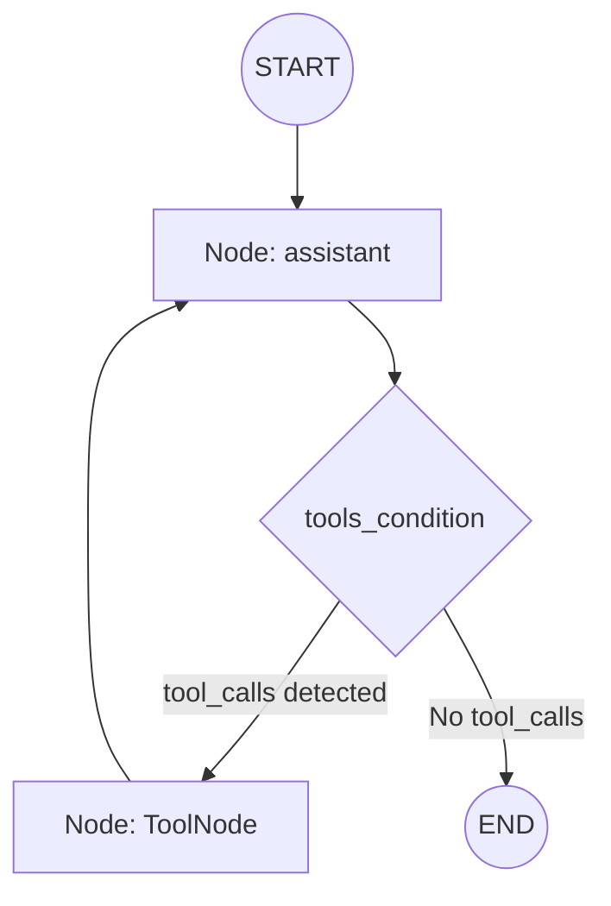

# Topic 06: ReAct Agent Architecture (Reason + Act)

Welcome to **Topic 06** of the LangGraph Components course. This module covers the foundational architecture of autonomous AI agents: the **ReAct (Reasoning + Acting)** cyclic loop.

---

## 🎯 Learning Objectives

By the end of this module, you will understand:
1. What the **ReAct (Reason + Act)** paradigm is and how it differs from hardcoded chains.
2. How `llm.bind_tools(tools)` informs the model about callable Python functions without executing them.
3. How LangGraph's prebuilt **`ToolNode`** automatically executes tool calls and generates `ToolMessage` objects.
4. How **`tools_condition`** routes dynamically: to `tools` if the model requested an action, or to `END` if the answer is complete.
5. Why the **cyclic edge (`tools -> assistant`)** is the secret sauce that allows the model to observe tool outputs and synthesize a human-friendly response.

---

## 🧠 Mental Model: The ReAct Cyclic Loop

Unlike fixed pipelines that proceed in a straight line, an agent can loop as many times as necessary until it has all the information it needs:

```
                      ┌──────────────────────┐
                      ▼                      │
[START] ──► [Assistant: LLM + Tools]         │
                      │                      │
                      ▼                      │
              [tools_condition]              │ (Cycle back with ToolMessage observation)
                 │         │                 │
    (Has tool_calls)     (No tool_calls)     │
                 │         │                 │
                 ▼         ▼                 │
          [ToolNode]     [END]               │
                 │                           │
                 └───────────────────────────┘
```

1. **Reason (Assistant Node):** The model receives the user's question. It analyzes available tools and determines: *"I need to call the `add(5, 5)` function."*
2. **Act (ToolNode):** The graph routes to `ToolNode`, which runs `add(5, 5)` in local Python and emits a `ToolMessage(content="10")`.
3. **Observe & Re-Reason (Cyclic Loop):** The `ToolMessage` flows back into `assistant`. The model observes `"10"`, realizes it now needs to multiply by `10`, and issues `multiply(10, 10)`.
4. **Final Answer:** When no further tools are needed, the model writes the final natural language answer and `tools_condition` routes to `END`.

---

## 🔄 Graph Topology & Prebuilt Components



### LangGraph Prebuilt Utilities Used:
- **`ToolNode(tools)`:** A pre-engineered node that parses `AIMessage.tool_calls`, executes each Python function with the specified arguments, and returns `ToolMessage` updates.
- **`tools_condition`:** A conditional edge function that inspects the latest message in state:
  ```python
  def tools_condition(state):
      last_message = state["messages"][-1]
      if getattr(last_message, "tool_calls", None):
          return "tools"
      return END
  ```

---

## 💻 Code Walkthrough

### 1. Defining Callable Tools with `@tool`
```python
from langchain_core.tools import tool

@tool
def add(a: float, b: float) -> float:
    """Add two numbers a and b."""
    return a + b

@tool
def multiply(a: float, b: float) -> float:
    """Multiply two numbers a and b."""
    return a * b

TOOLS = [add, multiply]
```
> [!TIP]
> The docstring is the **instruction manual** for the LLM! The model reads your docstring to understand *when* and *how* to use the tool.

### 2. Binding Tools to the LLM
```python
llm = get_llm()
llm_with_tools = llm.bind_tools(TOOLS)
```

### 3. Assembling the Cyclic Graph
```python
builder = StateGraph(AgentState)

builder.add_node("assistant", assistant_node)
builder.add_node("tools", ToolNode(TOOLS))

builder.add_edge(START, "assistant")
builder.add_conditional_edges("assistant", tools_condition)
# THE CRUCIAL CYCLIC EDGE:
builder.add_edge("tools", "assistant")

agent = builder.compile()
```

---

## 🚀 How to Run

From the project root:
```powershell
python 10_LangGrapph_Component/06_react_agent/main.py
```

Or from inside this directory:
```powershell
cd 10_LangGrapph_Component/06_react_agent
python main.py
```

---

## 📝 Summary Checklist

| Component | Responsibility |
|---|---|
| `@tool` | Turns standard Python functions into schemas the model can understand. |
| `bind_tools()` | Sends tool definitions to the provider (OpenAI, Groq, Google). |
| `ToolNode` | Runs the requested tools on your machine and generates `ToolMessage`s. |
| `tools_condition` | Decides whether to continue looping (`tools`) or terminate (`END`). |
| `tools -> assistant` | The return edge that lets the model see the tool's answer. |
