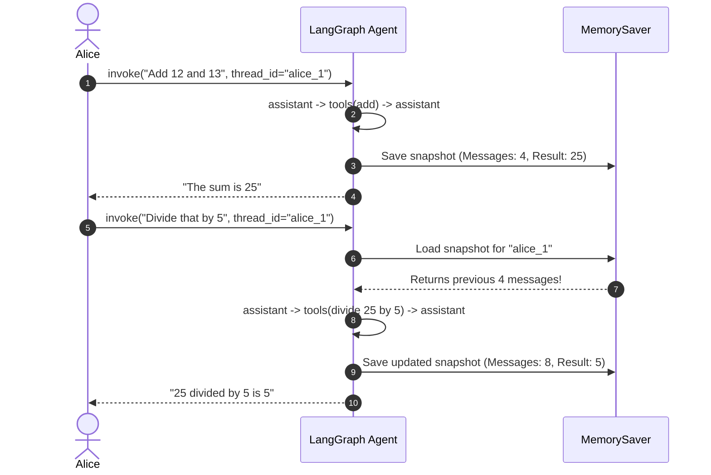

# Topic 07: Agent Memory & Checkpointing (MemorySaver)

Welcome to **Topic 07** of the LangGraph Components course. This module covers how to give your LangGraph agents stateful, multi-turn memory using **Checkpointers** and **`thread_id`**.

---

## 🎯 Learning Objectives

By the end of this module, you will understand:
1. Why vanilla LLMs and graphs are completely **stateless** between separate `.invoke()` calls.
2. What a **Checkpointer** (`MemorySaver`) is and how it saves a state snapshot after every node runs.
3. How **`thread_id`** isolates conversation threads so different users do not collide or share private memory.
4. How to perform multi-turn follow-up queries (e.g. *"Divide that by 5"*) without re-sending the past conversation history manually.
5. How to inspect state history and pending nodes using `agent.get_state(config)`.

---

## 🧠 Mental Model: Checkpointers & The Thread Index

Without a checkpointer, calling `.invoke()` is like talking to someone who resets their brain after every sentence:

```
WITHOUT CHECKPOINTER (Amnesia):
Turn 1: "Add 12 and 13"   ──► Agent computes: 25. (Memory wiped!)
Turn 2: "Divide that by 5"──► Agent: "Divide WHAT by 5? I don't know what you mean."
```

With a checkpointer (`MemorySaver`), LangGraph records a snapshot in a database indexed by `thread_id`:

```
                 CHECKPOINTER DATABASE (MemorySaver)
  ┌─────────────────────────────────────────────────────────────┐
  │ thread_id: "alice_1" ──► [Turn 1: 12+13=25, Turn 2: 25/5=5] │
  │ thread_id: "bob_2"   ──► [Turn 1: "Hello!"]                 │
  └─────────────────────────────────────────────────────────────┘
          ▲                                ▲
          │ config={"thread_id": "alice_1"}│ config={"thread_id": "bob_2"}
     Alice's Session                  Bob's Session
   (Recalls her 25!)               (Completely Isolated!)
```

When Alice asks *"Divide that by 5"*, LangGraph automatically loads the snapshot for `"alice_1"`, prepends it to the new message, and provides the full history to the model!

---

## 🔄 Execution Flow & Multi-Turn Timeline



---

## 💻 Code Walkthrough

### 1. Compiling with `MemorySaver`
```python
from langgraph.checkpoint.memory import MemorySaver

builder = StateGraph(PersistentAgentState)
# ... add nodes and edges ...

# Attach checkpointer during compilation!
checkpointer = MemorySaver()
agent = builder.compile(checkpointer=checkpointer)
```

### 2. Multi-Turn Invocations using `thread_id`
```python
config_alice = {"configurable": {"thread_id": "alice_1"}}

# Turn 1
agent.invoke({"messages": [HumanMessage("Add 12 and 13")]}, config=config_alice)

# Turn 2: Notice we ONLY pass the new question!
agent.invoke({"messages": [HumanMessage("Divide that by 5")]}, config=config_alice)
```

### 3. Inspecting the Checkpoint Snapshot
```python
snapshot = agent.get_state(config_alice)
print("Total messages in thread:", len(snapshot.values["messages"]))
print("Next step in graph:", snapshot.next)  # empty tuple () if completed
```

---

## 🚀 How to Run

From the project root:
```powershell
python 10_LangGrapph_Component/07_agent_memory_checkpointer/main.py
```

Or from inside this directory:
```powershell
cd 10_LangGrapph_Component/07_agent_memory_checkpointer
python main.py
```

---

## 📝 Summary Checklist

| Concept | Explanation |
|---|---|
| **MemorySaver** | In-memory checkpointer that snapshots state after every node execution. |
| **thread_id** | The unique session key separating different users/chats in the checkpointer. |
| **`compile(checkpointer=...)`** | Enables state persistence on the graph. |
| **`config={"configurable": {"thread_id": ...}}`** | Directs which conversation history to load and append to. |
| **Production Note** | `MemorySaver` lives in RAM. In production, use `SqliteSaver` or `PostgresSaver`. |
