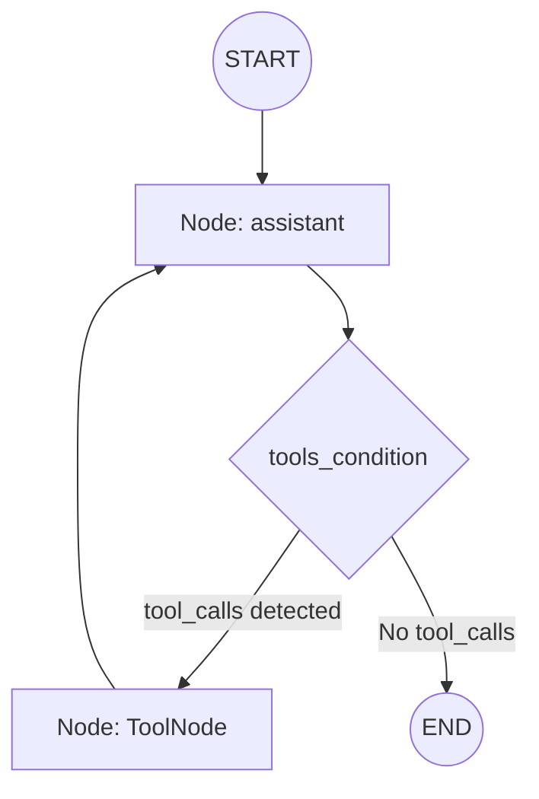

# Topic 09: Chains with Tools (The 3 Stages of Tool Calling)

Welcome to **Topic 09** of the LangGraph Components course. This module breaks down the mechanism of tool calling into **three progressive learning stages**.

---

## 🎯 Learning Objectives

By the end of this module, you will understand:
1. **Stage 1 (bind_tools):** Why models only *request* tool calls and do *not* run Python code themselves.
2. **Stage 2 (One-Node Chain):** What happens when a model requests a tool call but the graph has no `ToolNode` to execute it.
3. **Stage 3 (Full Cyclic Loop):** How `ToolNode` executes the function, emits a `ToolMessage`, and loops back to `assistant` to synthesize the final answer.
4. The difference between routing `tools -> END` (stops on raw JSON) vs `tools -> assistant` (produces natural language).

---

## 🧠 Mental Model: The 3 Stages of Tool Integration

```
STAGE 1: MODEL ALONE (bind_tools)
User: "What is 2+2?" ──► [LLM with Tools] ──► AIMessage(tool_calls=[{"name": "add", "args": {"a":2, "b":2}}])
(The model emitted a request, but NO Python code was executed!)

STAGE 2: ONE-NODE CHAIN (START -> assistant -> END)
[START] ──► [assistant] ──► [END]
(Graph terminates holding the unexecuted tool call!)

STAGE 3: FULL REACT CYCLE
[START] ──► [assistant] ──► (Has tool_calls?) ──► [ToolNode (Runs add(2,2))]
                 ▲                                        │
                 │                                        ▼
                 └─────────────────────────────── (ToolMessage: 4)
```

---

## 🔄 Graph Topology for Stage 3



---

## 💻 Code Walkthrough

### Stage 1: Inspecting a Tool Call
```python
llm_with_tools = get_llm().bind_tools([add])
response = llm_with_tools.invoke([HumanMessage(content="What is 2 plus 2? Use add.")])

# The model did not execute add()! It returned a structured dictionary:
print(response.tool_calls)
# [{'name': 'add', 'args': {'a': 2, 'b': 2}, 'id': 'call_123'}]
```

### Stage 2: The One-Node Gap
```python
builder = StateGraph(State)
builder.add_node("assistant", assistant)
builder.add_edge(START, "assistant")
builder.add_edge("assistant", END) # Stops here! Tool is never run.
```

### Stage 3: The Complete Loop with ToolNode
```python
builder = StateGraph(State)
builder.add_node("assistant", assistant)
builder.add_node("tools", ToolNode([add]))

builder.add_edge(START, "assistant")
builder.add_conditional_edges("assistant", tools_condition)
# Connect back to assistant so the model can turn "4" into an English sentence!
builder.add_edge("tools", "assistant")
```

---

## 🚀 How to Run

From the project root:
```powershell
python 10_LangGrapph_Component/09_chain_with_tools/main.py
```

Or from inside this directory:
```powershell
cd 10_LangGrapph_Component/09_chain_with_tools
python main.py
```

---

## 📝 Summary Checklist

| Stage | What Happens | Output Seen by User |
|---|---|---|
| **Stage 1 (`bind_tools`)** | Model generates tool JSON schema | Raw `AIMessage.tool_calls` |
| **Stage 2 (One Node)** | Graph stops at assistant | Unexecuted tool call |
| **Stage 3 (Full Loop)** | ToolNode executes + loops back | Natural language answer: *"2 + 2 equals 4."* |
