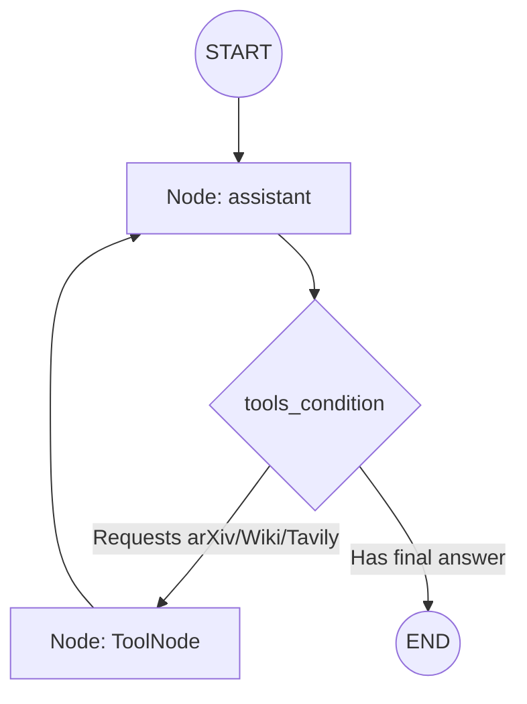

# Topic 11: Multi-Tool Chatbot

Welcome to **Topic 11** of the LangGraph Components course. This module brings together the research tools from Topic 10 (`arXiv`, `Wikipedia`, and `Tavily`) into a single, intelligent **Multi-Tool Agentic Chatbot**.

---

## 🎯 Learning Objectives

By the end of this module, you will understand:
1. How to bind multiple heterogeneous tools (`[search_arxiv, wikipedia, tavily]`) to an LLM simultaneously.
2. How the model autonomously routes between academic research, encyclopedia facts, and live web searches purely based on **semantic docstring matching**.
3. Why hardcoded routing rules (`if "paper" in text: ...`) are fragile and how LLM tool selection replaces them.
4. How the ReAct cyclic loop executes the selected tool and returns to `assistant` to synthesize a concise natural language summary.

---

## 🧠 Mental Model: The Autonomous Research Assistant

```
User Query: "Look up arXiv paper 1706.03762 and explain why it matters."
                            │
                            ▼
         ┌─────────────────────────────────────┐
         │          ASSISTANT (LLM)            │
         │ Evaluates available tool docstrings │
         └──────────────────┬──────────────────┘
                            │
           ┌────────────────┼────────────────┐
           │ (arXiv Paper)  │ (Definition)   │ (Live News)
           ▼                ▼                ▼
     search_arxiv       wikipedia          tavily
           │
           ▼
┌──────────────────────┐
│ ToolNode: Executes   │
│ arXiv paper search   │
└──────────┬───────────┘
           │ (ToolMessage observation: title, abstract, authors)
           ▼
┌──────────────────────┐
│ Assistant (LLM):     │
│ Synthesizes clean    │
│ final explanation    │
└──────────┬───────────┘
           ▼
        [ END ]
```

---

## 🔄 Graph Architecture



---

## 💻 Code Walkthrough

### 1. Dynamic Tool Suite Assembly
```python
def build_tools():
    tools = [search_arxiv, wiki]
    # Dynamically include Tavily only if the API key is present
    if os.getenv("TAVILY_API_KEY"):
        tools.append(TavilySearch(max_results=3))
    return tools
```

### 2. Multi-Tool Binding & Graph Wiring
```python
tools = build_tools()
llm_with_tools = get_llm().bind_tools(tools)

builder = StateGraph(State)
builder.add_node("assistant", assistant)
builder.add_node("tools", ToolNode(tools))

builder.add_edge(START, "assistant")
builder.add_conditional_edges("assistant", tools_condition)
builder.add_edge("tools", "assistant")

chatbot = builder.compile()
```

---

## 🚀 How to Run

From the project root:
```powershell
python 10_LangGrapph_Component/11_multi_tool_chatbot/main.py
```

Or from inside this directory:
```powershell
cd 10_LangGrapph_Component/11_multi_tool_chatbot
python main.py
```

---

## 📝 Summary Checklist

| Concept | Explanation |
|---|---|
| **Multi-Tool Binding** | Pass a list of tools: `llm.bind_tools([tool1, tool2, tool3])`. |
| **Docstring Authority** | The model relies 100% on docstrings to differentiate tool capabilities. |
| **Synthesis Cycle** | The loop `tools -> assistant` ensures the raw tool text is turned into an answer. |
| **Safe Fallbacks** | Inspect environment variables to only bind tools with valid API credentials. |
