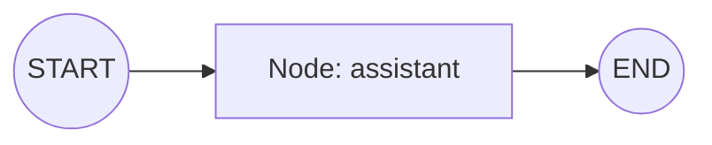

# Topic 12: Simple Chatbot with Thread Memory

Welcome to **Topic 12** of the LangGraph Components course. This module demonstrates the simplest possible conversational chatbot in LangGraph: a **single-node model** with **`MemorySaver`** thread memory and **no tools**.

---

## 🎯 Learning Objectives

By the end of this module, you will understand:
1. How to construct a minimalist 1-node conversational chatbot in LangGraph (`START -> assistant -> END`).
2. How `compile(checkpointer=MemorySaver())` activates state persistence.
3. How `config={"configurable": {"thread_id": "user-123"}}` maintains continuity between turns.
4. How session isolation works: verifying that Thread B cannot see or leak facts from Thread A.
5. Why this minimalist chatbot forms the clean baseline for **Streaming** in Topic 13.

---

## 🧠 Mental Model: The Minimalist Stateful Graph

Unlike ReAct agents that have loops and tools, this graph is a straight line:

```
[START] ──► [assistant (LLM)] ──► [END]
                   │
                   ▼ (Snapshotted to checkpointer)
   MemorySaver Database [thread_id: "krish-1"]
```

Even though the graph is a straight line, **it has memory** because the checkpointer stores the message list after every turn!

When you invoke the graph for Turn 2:
1. LangGraph looks up `"krish-1"` in the checkpointer.
2. It retrieves Turn 1: `[HumanMessage("Hi, I am Krish"), AIMessage("Hello Krish!")]`.
3. It appends the new question: `HumanMessage("What is my name?")`.
4. The assistant sees all 3 messages and replies: *"Your name is Krish."*

---

## 🔄 Graph Topology



---

## 💻 Code Walkthrough

### 1. State with `add_messages`
```python
class State(TypedDict):
    messages: Annotated[list[AnyMessage], add_messages]
```

### 2. Graph Definition with Checkpointer
```python
def build_chatbot():
    llm = get_llm(temperature=0)

    def assistant(state: State) -> dict:
        reply = llm.invoke(state["messages"])
        return {"messages": [reply]}

    builder = StateGraph(State)
    builder.add_node("assistant", assistant)
    builder.add_edge(START, "assistant")
    builder.add_edge("assistant", END)

    # Attach MemorySaver checkpointer at compile time!
    return builder.compile(checkpointer=MemorySaver())
```

### 3. Multi-Turn Invocations
```python
graph = build_chatbot()
config = {"configurable": {"thread_id": "krish-1"}}

# Turn 1
graph.invoke({"messages": [HumanMessage("My favorite sport is cricket.")]}, config)

# Turn 2: Same thread_id -> model recalls the sport!
graph.invoke({"messages": [HumanMessage("Which sport do I like?")]}, config)
```

---

## 🚀 How to Run

From the project root:
```powershell
python 10_LangGrapph_Component/12_simple_chatbot/main.py
```

Or from inside this directory:
```powershell
cd 10_LangGrapph_Component/12_simple_chatbot
python main.py
```

---

## 📝 Summary Checklist

| Concept | Explanation |
|---|---|
| **Single Node** | Pure conversation without tool branching (`START -> assistant -> END`). |
| **Checkpointer** | Saves state history snapshots automatically. |
| **thread_id** | The conversational identifier in `config`. Reusing it recalls history. |
| **Session Isolation** | Changing the `thread_id` starts a completely blank conversation. |
