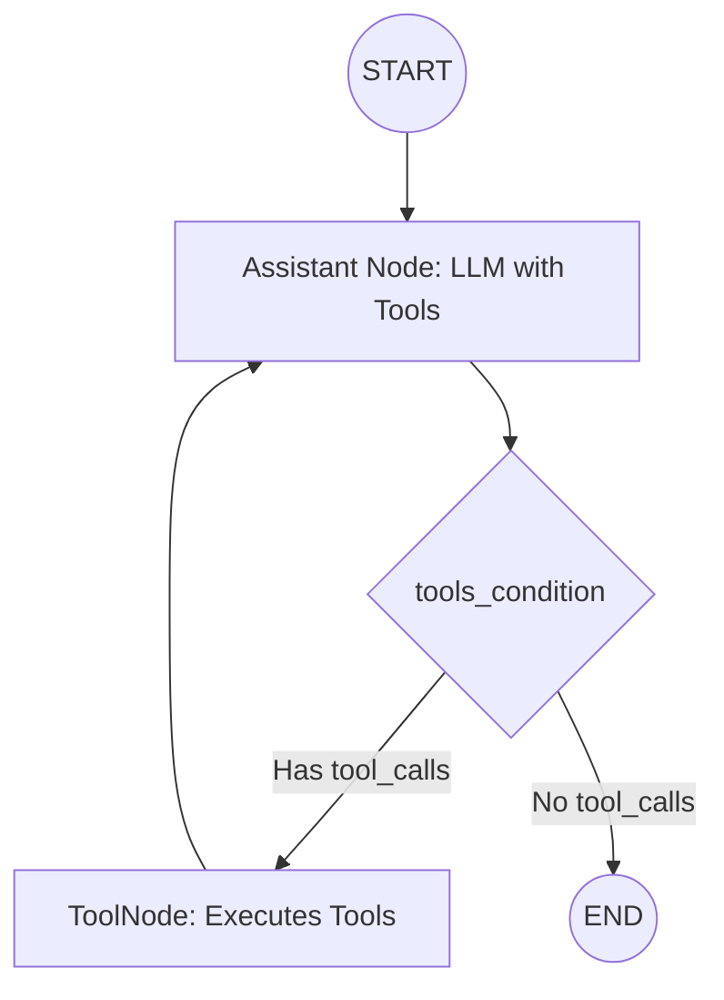

# LangGraph Components: Architecture, State Schemas, Chains & ReAct Agents

Welcome to the comprehensive guide for **LangGraph Components**. This directory contains modular, thoroughly explained, and crash-free implementations of every foundational building block of LangGraph.

---

## 📂 File Structure & Learning Roadmap

| # | File | Topic | Key Concepts |
|---|---|---|---|
| **01** | [`01_state_schema_typeddict.py`](file:///d:/Learning/KrishNaik/Agentic-AI/10_LangGrapph_Component/01_state_schema_typeddict.py) | **State Schema: TypedDict** | Dictionary syntax, fast execution, static type hints, conditional edges. |
| **02** | [`02_state_schema_dataclass.py`](file:///d:/Learning/KrishNaik/Agentic-AI/10_LangGrapph_Component/02_state_schema_dataclass.py) | **State Schema: DataClasses** | Object attribute access (`state.name`), default values, class methods. |
| **03** | [`03_state_schema_pydantic.py`](file:///d:/Learning/KrishNaik/Agentic-AI/10_LangGrapph_Component/03_state_schema_pydantic.py) | **State Schema: Pydantic** | **Runtime validation**, type coercion, field bounds, input sanitization. |
| **04** | [`04_state_reducers.py`](file:///d:/Learning/KrishNaik/Agentic-AI/10_LangGrapph_Component/04_state_reducers.py) | **State Reducers** | **Crucial Concept**: Overwriting vs Accumulating (`Annotated[..., add_messages]`). |
| **05** | [`05_chains_langgraph.py`](file:///d:/Learning/KrishNaik/Agentic-AI/10_LangGrapph_Component/05_chains_langgraph.py) | **Chains & Workflows** | Sequential pipelines (Draft $\to$ Critique $\to$ Polish) & Parallel Fan-out / Fan-in. |
| **06** | [`06_react_agent.py`](file:///d:/Learning/KrishNaik/Agentic-AI/10_LangGrapph_Component/06_react_agent.py) | **ReAct Agent Architecture** | `ToolNode`, `tools_condition`, dynamic reasoning, cyclic graph loops. |
| **07** | [`07_agent_memory_checkpointer.py`](file:///d:/Learning/KrishNaik/Agentic-AI/10_LangGrapph_Component/07_agent_memory_checkpointer.py) | **Memory & Checkpointing** | `MemorySaver`, `thread_id` session isolation, multi-turn state persistence. |
| **08** | [`08_messages_and_chat_models.py`](file:///d:/Learning/KrishNaik/Agentic-AI/10_LangGrapph_Component/08_messages_and_chat_models.py) | **Messages & Chat Models** | `HumanMessage`, `AIMessage`, `SystemMessage`, `invoke`, `response_metadata`. |
| **09** | [`09_chain_with_tools.py`](file:///d:/Learning/KrishNaik/Agentic-AI/10_LangGrapph_Component/09_chain_with_tools.py) | **Chain With a Tool** | `bind_tools`, one-node chain, `ToolNode` loop back to the model. |
| **10** | [`10_search_tools.py`](file:///d:/Learning/KrishNaik/Agentic-AI/10_LangGrapph_Component/10_search_tools.py) | **Search Tools Alone** | Arxiv, Wikipedia, and Tavily called directly. |
| **11** | [`11_multi_tool_chatbot.py`](file:///d:/Learning/KrishNaik/Agentic-AI/10_LangGrapph_Component/11_multi_tool_chatbot.py) | **Multi-Tool Chatbot** | Model picks Arxiv, Wikipedia, or Tavily, then summarizes. |
| **12** | [`12_simple_chatbot.py`](file:///d:/Learning/KrishNaik/Agentic-AI/10_LangGrapph_Component/12_simple_chatbot.py) | **Plain Chatbot Memory** | One-node chatbot, `MemorySaver`, separate `thread_id`s. |
| **13** | [`13_streaming.py`](file:///d:/Learning/KrishNaik/Agentic-AI/10_LangGrapph_Component/13_streaming.py) | **Streaming** | `stream_mode="updates"`, `stream_mode="values"`, token events. |
| **Ref**| [`ReActAgents.py`](file:///d:/Learning/KrishNaik/Agentic-AI/10_LangGrapph_Component/ReActAgents.py) | **Unified ReAct Runner** | Complete clean runner combining tools, ReAct loop, and memory. |

---

## 🧠 Core LangGraph Concepts: What You Need to Know

### 1. State Schemas: Which One Should You Choose?

In LangGraph, **State** is the single source of truth passed to every node. You have 3 primary ways to define it:

```
┌──────────────────────────────────────────────────────────────────────────┐
│                           STATE SCHEMA OPTIONS                           │
├─────────────────────┬──────────────────────┬─────────────────────────────┤
│ TypedDict           │ Dataclass            │ Pydantic BaseModel          │
├─────────────────────┼──────────────────────┼─────────────────────────────┤
│ • Uses dict syntax  │ • Dot notation       │ • Strict runtime validation │
│   state['name']     │   state.name         │ • Type coercion             │
│ • Zero overhead     │ • Default values     │ • Field constraints (ge=0)  │
│ • NO runtime check  │ • NO runtime check   │ • Blocks bad API inputs     │
│   {"age": "bad"}    │   {"age": "bad"}     │ • Production standard       │
│   will NOT fail!    │   will NOT fail!     │   for webhooks / APIs       │
└─────────────────────┴──────────────────────┴─────────────────────────────┘
```

> [!WARNING]
> **Python Shadowing Pitfall:** Never name your local file `pydantic.py`! Python resolves local filenames before installed packages. A local file named `pydantic.py` shadows the third-party `pydantic` package and causes all project imports of Pydantic to fail with `ImportError`.

---

### 2. State Reducers: Overwriting vs. Accumulating

This is the **#1 trap** for newcomers to LangGraph.

When a node returns a dictionary `{"messages": [new_msg]}`, what happens to the existing messages?

* **WITHOUT a Reducer:**
  LangGraph **OVERWRITES** the state key.
  ```python
  class BadState(TypedDict):
      messages: list  # Node 2 replaces Node 1's messages!
  ```
* **WITH a Reducer (`Annotated`):**
  LangGraph calls the reducer function to merge/append the update to existing state.
  ```python
  from langgraph.graph.message import add_messages

  class GoodState(TypedDict):
      # add_messages appends new messages, tracks IDs, and avoids duplicates!
      messages: Annotated[list, add_messages]
  ```

---

### 3. ReAct Agent Architecture (Reason + Act)

A ReAct agent combines reasoning and acting in a cyclic loop:



1. **Assistant Node:** Invokes the LLM with `bind_tools(tools)`.
2. **`tools_condition`:** Inspects the last message. If the model generated `tool_calls`, it routes to the `tools` node; otherwise, it routes to `END`.
3. **`ToolNode`:** Executes the function locally and appends a `ToolMessage` to the state.
4. **Cyclic Edge (`tools -> assistant`):** Feeds the tool observation back to the model so it can reason over the answer!

---

### 4. Memory & Checkpointing (`MemorySaver` & `thread_id`)

LLMs and vanilla graphs are stateless. To enable multi-turn memory:

1. **Checkpointer:** `MemorySaver()` writes snapshots of the graph state to memory after each step.
2. **`thread_id`:** Indexes conversations so different users don't share or collide with each other's state:
   ```python
   # Session for Alice
   config = {"configurable": {"thread_id": "alice_123"}}
   agent.invoke({"messages": [HumanMessage("Add 12 and 13")]}, config=config)

   # Follow-up: Alice does not need to repeat the numbers!
   agent.invoke({"messages": [HumanMessage("Divide that by 5")]}, config=config)
   ```

---

## 🚀 How to Run the Code

Run any script directly using your project virtual environment:

```powershell
# 1. State Schema with TypedDict
python 10_LangGrapph_Component/01_state_schema_typeddict.py

# 2. State Schema with Dataclasses
python 10_LangGrapph_Component/02_state_schema_dataclass.py

# 3. State Schema with Pydantic Runtime Validation
python 10_LangGrapph_Component/03_state_schema_pydantic.py

# 4. State Reducers (Overwriting vs Accumulating)
python 10_LangGrapph_Component/04_state_reducers.py

# 5. Chains & Workflows (Sequential & Parallel)
python 10_LangGrapph_Component/05_chains_langgraph.py

# 6. ReAct Agent Architecture
python 10_LangGrapph_Component/06_react_agent.py

# 7. Agent Memory & Multi-Turn Checkpointing
python 10_LangGrapph_Component/07_agent_memory_checkpointer.py

# 8. Chat messages, then a real chat-model call
python 10_LangGrapph_Component/08_messages_and_chat_models.py

# 9. bind_tools, a one-node chain, then a chain that runs the tool
python 10_LangGrapph_Component/09_chain_with_tools.py

# 10. Arxiv, Wikipedia, and Tavily by themselves
python 10_LangGrapph_Component/10_search_tools.py

# 11. Chatbot that chooses among those tools
python 10_LangGrapph_Component/11_multi_tool_chatbot.py

# 12. Plain chatbot with thread memory
python 10_LangGrapph_Component/12_simple_chatbot.py

# 13. Stream updates, full state, or tokens
python 10_LangGrapph_Component/13_streaming.py
```

Lessons 08 through 13 keep one example running inside `main()`. Comment that call and uncomment the next function when you want the next example.

`ChainsLangGraph.py`, `chatbotswithmultipletools.py`, and `streaming.py` were the original notebook dumps. They now point at the lessons above.

Tavily examples need `TAVILY_API_KEY` in the project `.env`. Arxiv and Wikipedia do not.

`GROQ_MODEL` in `.env` is `openai/gpt-oss-120b`. Groq no longer serves `llama-3.3-70b-versatile`, which is what the notebooks used to call.

The combined ReAct runner is still `ReActAgents.py`.

