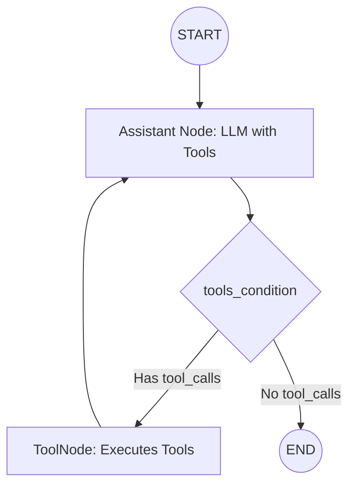

# LangGraph Components: Architecture, State Schemas, Chains & ReAct Agents

Welcome to the comprehensive, hands-on learning hub for **LangGraph Components**. Every topic in this curriculum is organized into its own dedicated folder containing:
1. An in-depth **`README.md`** explaining core theory, flow diagrams, state transitions, and edge cases.
2. A clean, fully annotated **`main.py`** script with step-by-step flow comments, mental models, and revision notes.

---

## 📂 Modular Curriculum & Folder Structure

| # | Topic Directory | Code File | Key Learning Objectives |
|---|---|---|---|
| **01** | [**`01_state_schema_typeddict/`**](file:///d:/Learning/KrishNaik/Agentic-AI/10_LangGrapph_Component/01_state_schema_typeddict/README.md) | [`main.py`](file:///d:/Learning/KrishNaik/Agentic-AI/10_LangGrapph_Component/01_state_schema_typeddict/main.py) | **State Schema: TypedDict**<br>Dictionary syntax, fast execution, static type hints, conditional edges, lack of runtime enforcement. |
| **02** | [**`02_state_schema_dataclass/`**](file:///d:/Learning/KrishNaik/Agentic-AI/10_LangGrapph_Component/02_state_schema_dataclass/README.md) | [`main.py`](file:///d:/Learning/KrishNaik/Agentic-AI/10_LangGrapph_Component/02_state_schema_dataclass/main.py) | **State Schema: DataClasses**<br>Object attribute dot access (`state.name`), default values (`score=0`), class helper methods, automatic dict coercion. |
| **03** | [**`03_state_schema_pydantic/`**](file:///d:/Learning/KrishNaik/Agentic-AI/10_LangGrapph_Component/03_state_schema_pydantic/README.md) | [`main.py`](file:///d:/Learning/KrishNaik/Agentic-AI/10_LangGrapph_Component/03_state_schema_pydantic/main.py) | **State Schema: Pydantic**<br>**Strict runtime validation**, type coercion, field constraints (`ge=5`), custom `@field_validator`s, input sanitization. |
| **04** | [**`04_state_reducers/`**](file:///d:/Learning/KrishNaik/Agentic-AI/10_LangGrapph_Component/04_state_reducers/README.md) | [`main.py`](file:///d:/Learning/KrishNaik/Agentic-AI/10_LangGrapph_Component/04_state_reducers/main.py) | **State Reducers**<br>**Crucial Concept**: Overwriting vs Accumulating (`Annotated[..., operator.add]` vs `Annotated[..., add_messages]`). |
| **05** | [**`05_chains_langgraph/`**](file:///d:/Learning/KrishNaik/Agentic-AI/10_LangGrapph_Component/05_chains_langgraph/README.md) | [`main.py`](file:///d:/Learning/KrishNaik/Agentic-AI/10_LangGrapph_Component/05_chains_langgraph/main.py) | **Chains & Workflows**<br>Sequential pipelines (Draft $\to$ Critique $\to$ Polish) & Parallel Fan-out / Fan-in (Tech + Market $\to$ Synthesis). |
| **06** | [**`06_react_agent/`**](file:///d:/Learning/KrishNaik/Agentic-AI/10_LangGrapph_Component/06_react_agent/README.md) | [`main.py`](file:///d:/Learning/KrishNaik/Agentic-AI/10_LangGrapph_Component/06_react_agent/main.py) | **ReAct Agent Architecture**<br>`ToolNode`, `tools_condition`, dynamic reasoning, and the cyclic loop (`tools -> assistant`). |
| **07** | [**`07_agent_memory_checkpointer/`**](file:///d:/Learning/KrishNaik/Agentic-AI/10_LangGrapph_Component/07_agent_memory_checkpointer/README.md) | [`main.py`](file:///d:/Learning/KrishNaik/Agentic-AI/10_LangGrapph_Component/07_agent_memory_checkpointer/main.py) | **Memory & Checkpointing**<br>`MemorySaver`, `thread_id` session isolation, multi-turn state persistence across `.invoke()` calls. |
| **08** | [**`08_messages_and_chat_models/`**](file:///d:/Learning/KrishNaik/Agentic-AI/10_LangGrapph_Component/08_messages_and_chat_models/README.md) | [`main.py`](file:///d:/Learning/KrishNaik/Agentic-AI/10_LangGrapph_Component/08_messages_and_chat_models/main.py) | **Messages & Chat Models**<br>`HumanMessage`, `AIMessage`, `SystemMessage`, `pretty_print()`, and inspecting `response_metadata`. |
| **09** | [**`09_chain_with_tools/`**](file:///d:/Learning/KrishNaik/Agentic-AI/10_LangGrapph_Component/09_chain_with_tools/README.md) | [`main.py`](file:///d:/Learning/KrishNaik/Agentic-AI/10_LangGrapph_Component/09_chain_with_tools/main.py) | **Chain With a Tool**<br>The 3 progressive stages: raw `bind_tools`, 1-node chain, and the full ToolNode loop back to the assistant. |
| **10** | [**`10_search_tools/`**](file:///d:/Learning/KrishNaik/Agentic-AI/10_LangGrapph_Component/10_search_tools/README.md) | [`main.py`](file:///d:/Learning/KrishNaik/Agentic-AI/10_LangGrapph_Component/10_search_tools/main.py) | **Search Tools Alone**<br>arXiv research client, Wikipedia summaries, and Tavily real-time web search tested independently. |
| **11** | [**`11_multi_tool_chatbot/`**](file:///d:/Learning/KrishNaik/Agentic-AI/10_LangGrapph_Component/11_multi_tool_chatbot/README.md) | [`main.py`](file:///d:/Learning/KrishNaik/Agentic-AI/10_LangGrapph_Component/11_multi_tool_chatbot/main.py) | **Multi-Tool Chatbot**<br>Autonomous model routing between arXiv, Wikipedia, and Tavily based on semantic docstrings. |
| **12** | [**`12_simple_chatbot/`**](file:///d:/Learning/KrishNaik/Agentic-AI/10_LangGrapph_Component/12_simple_chatbot/README.md) | [`main.py`](file:///d:/Learning/KrishNaik/Agentic-AI/10_LangGrapph_Component/12_simple_chatbot/main.py) | **Plain Chatbot Memory**<br>Minimalist 1-node conversational chatbot, `MemorySaver`, and strict `thread_id` session isolation. |
| **13** | [**`13_streaming/`**](file:///d:/Learning/KrishNaik/Agentic-AI/10_LangGrapph_Component/13_streaming/README.md) | [`main.py`](file:///d:/Learning/KrishNaik/Agentic-AI/10_LangGrapph_Component/13_streaming/main.py) | **Streaming**<br>`stream_mode="updates"`, `stream_mode="values"`, and real-time token streaming with `astream_events("v2")`. |

---

## 🧠 Core LangGraph Concepts: Quick Reference

### 1. State Schemas: Which One Should You Choose?

In LangGraph, **State** is the single source of truth passed to every node. You have 3 primary ways to define it:

```
┌──────────────────────────────────────────────────────────────────────────┐
│                           STATE SCHEMA OPTIONS                           │
├─────────────────────┬──────────────────────┬─────────────────────────────┤
│ TypedDict           │ Dataclass            │ Pydantic BaseModel          │
├─────────────────────┼──────────────────────┼─────────────────────────────┤
│ • Uses dict syntax  │ • Dot notation       │ • Strict runtime validation │
│   state['name']     │   state.name         │ • Type coercion             │
│ • Zero overhead     │ • Default values     │ • Field constraints (ge=0)  │
│ • NO runtime check  │ • NO runtime check   │ • Blocks bad API inputs     │
│   {"age": "bad"}    │   {"age": "bad"}     │ • Production standard       │
│   will NOT fail!    │   will NOT fail!     │   for webhooks / APIs       │
└─────────────────────┴──────────────────────┴─────────────────────────────┘
```

> [!WARNING]
> **Python Shadowing Pitfall:** Never name your local file `pydantic.py`! Python resolves local filenames before installed packages. A local file named `pydantic.py` shadows the third-party `pydantic` package and causes all project imports of Pydantic to fail with `ImportError`.

---

### 2. State Reducers: Overwriting vs. Accumulating

When a node returns a dictionary `{"messages": [new_msg]}`, what happens to the existing messages?

* **WITHOUT a Reducer:** LangGraph **OVERWRITES** the state key.
  ```python
  class BadState(TypedDict):
      messages: list  # Node 2 replaces Node 1's messages!
  ```
* **WITH a Reducer (`Annotated`):** LangGraph calls the reducer function to merge or append updates to existing state:
  ```python
  from langgraph.graph.message import add_messages

  class GoodState(TypedDict):
      # add_messages appends new messages, tracks IDs, and avoids duplicates!
      messages: Annotated[list, add_messages]
  ```

---

### 3. ReAct Agent Architecture (Reason + Act)

A ReAct agent combines reasoning and acting in a cyclic loop:



1. **Assistant Node:** Invokes the LLM with `bind_tools(tools)`.
2. **`tools_condition`:** Inspects the last message. If the model generated `tool_calls`, it routes to the `tools` node; otherwise, it routes to `END`.
3. **`ToolNode`:** Executes the function locally and appends a `ToolMessage` to the state.
4. **Cyclic Edge (`tools -> assistant`):** Feeds the tool observation back to the model so it can reason over the answer!

---

### 4. Memory & Checkpointing (`MemorySaver` & `thread_id`)

LLMs and vanilla graphs are stateless. To enable multi-turn memory:
1. **Checkpointer:** `MemorySaver()` writes snapshots of the graph state to memory after each step.
2. **`thread_id`:** Indexes conversations so different users don't share or collide with each other's state:
   ```python
   # Session for Alice
   config = {"configurable": {"thread_id": "alice_123"}}
   agent.invoke({"messages": [HumanMessage("Add 12 and 13")]}, config=config)

   # Follow-up: Alice does not need to repeat the numbers!
   agent.invoke({"messages": [HumanMessage("Divide that by 5")]}, config=config)
   ```

---

## 🚀 How to Run Any Topic

You can run any topic either from the project root or from inside that topic's directory:

```powershell
# Run from project root:
python 10_LangGrapph_Component/01_state_schema_typeddict/main.py
python 10_LangGrapph_Component/02_state_schema_dataclass/main.py
python 10_LangGrapph_Component/03_state_schema_pydantic/main.py
python 10_LangGrapph_Component/04_state_reducers/main.py
python 10_LangGrapph_Component/05_chains_langgraph/main.py
python 10_LangGrapph_Component/06_react_agent/main.py
python 10_LangGrapph_Component/07_agent_memory_checkpointer/main.py
python 10_LangGrapph_Component/08_messages_and_chat_models/main.py
python 10_LangGrapph_Component/09_chain_with_tools/main.py
python 10_LangGrapph_Component/10_search_tools/main.py
python 10_LangGrapph_Component/11_multi_tool_chatbot/main.py
python 10_LangGrapph_Component/12_simple_chatbot/main.py
python 10_LangGrapph_Component/13_streaming/main.py

# Or navigate into any folder:
cd 10_LangGrapph_Component/01_state_schema_typeddict
python main.py
```
