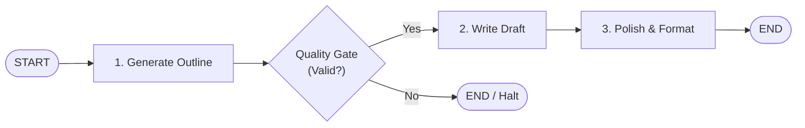
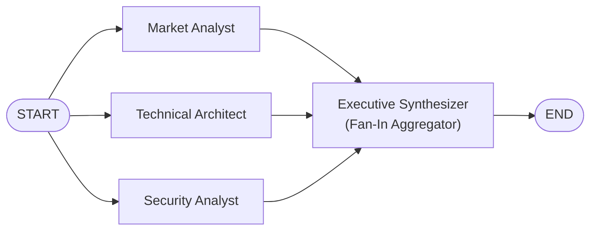
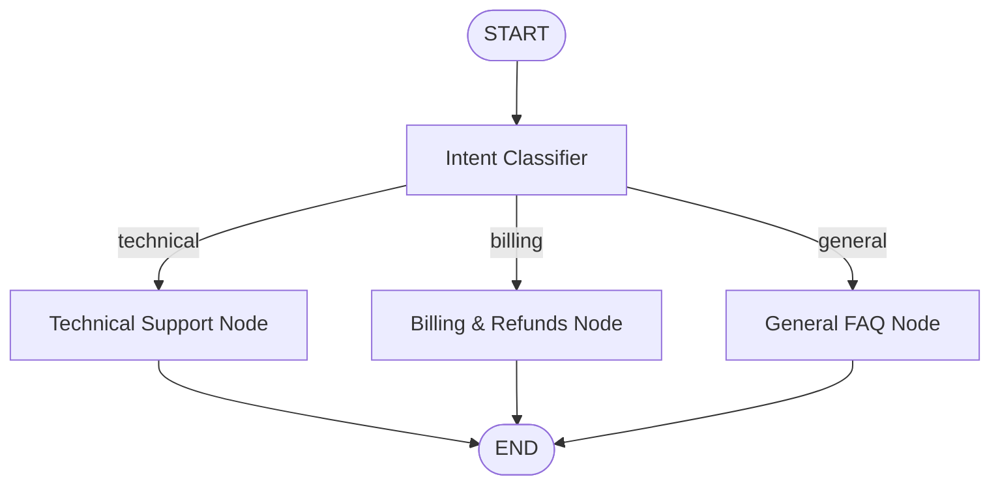
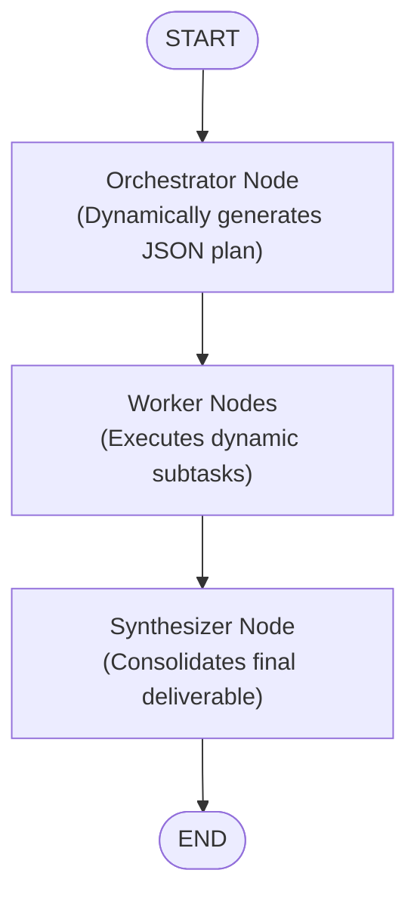

# 🌐 Section 14: Different Workflows in LangGraph

A complete, practical implementation of the **5 Core Agentic Workflow Design Patterns** in LangGraph (as formalized in Anthropic's *"Building Effective Agents"* and Krish Naik's *Section 14*).

---

## 📂 Curriculum & Code Structure

| Lesson # | File | Pattern Name | Key Mechanism | Best Used For |
| :--- | :--- | :--- | :--- | :--- |
| **109 & 110** | [`01_prompt_chaining.py`](./01_prompt_chaining.py) | **Prompt Chaining** | Sequential linear pipeline with programmatic quality gates | Tasks with clear, sequential steps (Outline $\to$ Draft $\to$ Polish) |
| **111** | [`02_parallelization.py`](./02_parallelization.py) | **Parallelization** | Concurrent Fan-Out branches with synchronized Fan-In aggregation | Multi-perspective evaluations, safety guardrails, voting ensembles |
| **112** | [`03_routing.py`](./03_routing.py) | **Routing** | Intent classifier with `add_conditional_edges` | Directing diverse requests to specialized domain experts or models |
| **113 & 114** | [`04_orchestrator_worker.py`](./04_orchestrator_worker.py) | **Orchestrator-Worker** | Dynamic runtime subtask planning, delegation, and synthesis | Complex goals with unpredictable subtasks planned on the fly |
| **115** | [`05_evaluator_optimizer.py`](./05_evaluator_optimizer.py) | **Evaluator-Optimizer** | Cyclic feedback loop (Generator $\leftrightarrow$ Evaluator) | Code generation, complex translation, high-stakes formal writing |

---

## 🧠 Architectural Deep-Dive for Each Workflow

### 1. Prompt Chaining (`01_prompt_chaining.py`)

Decomposes a complex goal into a sequence of smaller, focused prompts where intermediate outputs can be inspected and validated before proceeding.



* **Key Takeaway:** Avoids "context drift" and hallucinations common in single monolithic prompts. Allows programmatic validation between steps.

---

### 2. Parallelization (`02_parallelization.py`)

Executes multiple independent tasks concurrently. In LangGraph, declaring multiple edges from a single source node (`START -> NodeA`, `START -> NodeB`) triggers parallel execution. LangGraph automatically synchronizes the fan-in node to wait for all branches.



* **State Reducer:** Uses `Annotated[List[str], operator.add]` so parallel nodes append their reviews safely without overwriting each other.

---

### 3. Routing (`03_routing.py`)

Analyzes user input and directs it to a dedicated specialist node tailored specifically for that task.



* **Key Takeaway:** Prevents prompt bloating. Keeps tools isolated (e.g., Stripe API only accessible to Billing node, not General FAQ).

---

### 4. Orchestrator-Worker (`04_orchestrator_worker.py`)

Unlike fixed graphs, the Orchestrator analyzes the user's objective and dynamically plans $K$ subtasks at runtime. It delegates these tasks to Workers and synthesizes their deliverables.



* **Key Takeaway:** Ideal when the required steps cannot be predicted before seeing the prompt (e.g. writing documentation for an arbitrary codebase or multi-faceted product launch).

---

### 5. Evaluator-Optimizer (`05_evaluator_optimizer.py`)

Leverages the asymmetry between generation and evaluation: LLMs can critique flawed drafts far better than they can produce perfect drafts on the first attempt. Creates a self-correcting cycle.

```mermaid
flowchart TD
    Start([START]) --> Gen["Generator Node\n(Drafts / Revises code)"]
    Gen --> Eval["Evaluator Node\n(Scores 1-10 & writes feedback)"]
    Eval --> Check{"Score >= 8 OR\nMax Retries?"}
    Check -- No (Score < 8) -->|Loop back with Feedback| Gen
    Check -- Yes --> Finish([END])
```

* **Safety Guard:** Always maintain an `iteration_count` and `max_iterations` ceiling in the State to prevent runaway infinite token spend.

---

## 📊 Comparative Workflow Decision Matrix

| Workflow Pattern | Latency | Token Cost | Structural Flexibility | Self-Correction |
| :--- | :--- | :--- | :--- | :--- |
| **Prompt Chaining** | Low | Low | Fixed (Sequential) | None (Gates only) |
| **Parallelization** | Fast (Concurrent) | Medium | Fixed (Fan-Out/In) | None |
| **Routing** | Lowest | Lowest | Branching | None |
| **Orchestrator-Worker** | Medium | Medium-High | Dynamic (Runtime Plan) | Low |
| **Evaluator-Optimizer** | High (Multi-turn) | High | Cyclic (Looping) | **Highest** |

---

## 🚀 How to Run the Lessons

Make sure your virtual environment is active and your `.env` contains your `GROQ_API_KEY`, `GOOGLE_API_KEY`, or `OPENAI_API_KEY`.

Run any pattern directly:

```powershell
# 1. Prompt Chaining
python "12_Different Workflows In LangGraph/01_prompt_chaining.py"

# 2. Parallelization
python "12_Different Workflows In LangGraph/02_parallelization.py"

# 3. Routing
python "12_Different Workflows In LangGraph/03_routing.py"

# 4. Orchestrator-Worker
python "12_Different Workflows In LangGraph/04_orchestrator_worker.py"

# 5. Evaluator-Optimizer
python "12_Different Workflows In LangGraph/05_evaluator_optimizer.py"
```
